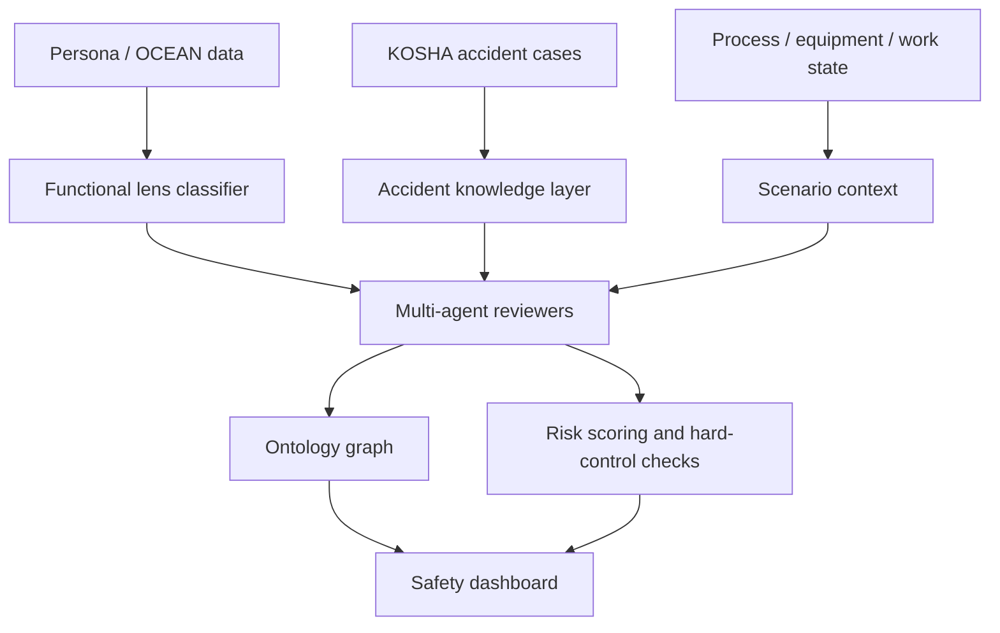

# Architecture

## Design boundary
Persona changes the questions and review lens, not the worker's risk probability. Historical accident narratives provide hazard/control knowledge; real-time detection requires operational signals and validation.
